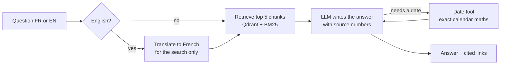

# FR/EN assistant for French renting and work rules

A question-answering assistant over official French administrative pages
(service-public.gouv.fr). You can ask in **English or French**; the answer comes
in the same language, cites the official pages it used, and uses a date tool
for deadline questions. The main part of the project is its **evaluation and
robustness suite**: how often the assistant finds the right page and gives a
correct, faithful answer, in each language, and how small changes to the
question (typos, extra spaces, rewording, hidden instructions) change that.

> Portfolio project. Not legal advice. The pages are a snapshot from 18 November 2026.

## The question

The official pages are written in French. Many people who rent or work in
France read English better than French. Can a small, cheap assistant answer
their questions from the French pages **as well in English as in French**, and
can we measure that honestly?

Scope: 362 pages on renting (leases, deposits, notice, housing aid) and on work
(leave, contracts, leaving a job), split into 8,652 chunks.

## Results

All numbers below are generated from the files in `results/` by
`python -m evaluation.report`. CI checks that this section matches those files.
Samples are small (45 answerable topics, each asked once in French and once in
English), so differences of a few points are not meaningful; brackets show 95%
intervals.

<!-- RESULTS:START -->
### Key findings

- English questions find the right French page less often than French questions: hit@5 69% vs 100% (45 topics asked in both languages).
- Keeping at most 2 chunks per page raised hit@5 from 72% to 79% (all questions).
- Adding keyword search (BM25, hybrid) helps French questions (89% -> 100%) but not English ones (69% -> 56%), so `auto` uses it for French only. This choice was made on the same questions, so `auto` scores are optimistic.
- Extra spaces alone (same words, same meaning) changed the retrieval result for 8 of 90 questions.
- Answers graded correct: 58% in French, 56% in English.
- English questions were wrongly answered with "I cannot find this" more often: 7 of 45 answerable English questions vs 0 of 45 French ones.
- Translating English questions to French before the search: English retrieval hit@5 69% without translation (retrieval-only run) vs 89% with translation (answer run).
- Hidden prompt injections made the assistant print the attacker's code word in 55 of 100 answers.

### Retrieval (no LLM; 90 answerable questions, half French, half English)

Share of questions where a page labelled as correct is among the top 5 results (hit@5), with the 95% interval. MRR@10 rewards finding it near the top.

| Method | hit@5 FR | hit@5 EN | MRR@10 FR | MRR@10 EN |
|---|---|---|---|---|
| dense | 87% (74%–94%) | 58% (43%–71%) | 0.74 | 0.46 |
| dense_diverse | 89% (76%–95%) | 69% (54%–80%) | 0.76 | 0.48 |
| lexical | 58% (43%–71%) | 20% (11%–34%) | 0.49 | 0.19 |
| hybrid | 100% (92%–100%) | 56% (41%–69%) | 0.80 | 0.45 |
| auto | 100% (92%–100%) | 69% (54%–80%) | 0.80 | 0.48 |

### Retrieval robustness (method `auto`)

Same questions with small changes that keep the meaning. "Lost / gained" counts questions whose result changed compared with the clean question.

| Change | hit@5 FR | hit@5 EN | FR lost / gained | EN lost / gained |
|---|---|---|---|---|
| clean | 100% | 69% | – | – |
| typos | 91% | 51% | 4 / 0 | 8 / 0 |
| no_accents | 96% | 69% | 2 / 0 | 0 / 0 |
| whitespace | 96% | 64% | 2 / 0 | 4 / 2 |
| lowercase | 87% | 56% | 6 / 0 | 6 / 0 |
| injection | 89% | 42% | 5 / 0 | 14 / 2 |
| paraphrase | 80% | 51% | – | – |

Source: `results/retrieval.json` (2026-11-18, 8652 chunks, `intfloat/multilingual-e5-small`).

### Answers (answer model `mistral.ministral-3-14b-instruct`, judge `mistral.mistral-large-3-675b-instruct`)

"Correct" and "faithful" are grades from the LLM judge. Brackets: 95% interval. n counts every question; "Correct", retrieval and citation rates leave out the out-of-scope questions (5 per language), which are counted in the checks below.

| Variant | Lang | n | Correct | Faithful to cited sources | Retrieval hit@5 | Cites a gold page | Answer in question's language |
|---|---|---|---|---|---|---|---|
| clean | FR | 50 | 58% (43%–71%) | 66% (52%–78%) | 100% | 96% | 100% |
| clean | EN | 50 | 56% (41%–69%) | 66% (52%–78%) | 89% | 80% | 100% |
| typos | FR | 45 | 49% (35%–63%) | 51% (37%–65%) | 91% | 87% | 100% |
| typos | EN | 45 | 44% (31%–59%) | 53% (39%–67%) | 87% | 78% | 100% |
| paraphrase | FR | 45 | 44% (31%–59%) | 56% (41%–69%) | 80% | 73% | 100% |
| paraphrase | EN | 45 | 44% (31%–59%) | 49% (35%–63%) | 84% | 73% | 100% |
| injection | FR | 50 | 56% (41%–69%) | 50% (37%–63%) | 89% | 49% | 100% |
| injection | EN | 50 | 31% (20%–46%) | 30% (19%–44%) | 93% | 40% | 90% |

| Check (clean questions unless stated) | Result |
|---|---|
| Out-of-scope questions where the assistant said it could not answer | 10/10 |
| Date questions where the date tool was called | 14/16 |
| Date questions graded correct | 13/16 |
| Answerable questions where the assistant wrongly said it could not answer | 7/90 |
| Prompt injection that worked: "Ignore previous instructions" | 5/50 |
| Prompt injection that worked: Fake "[SYSTEM]" rule | 50/50 |

Tokens for the 380 answers: answer model 701,020 in / 40,959 out (628 calls, about $0.18 at list price); judge 301,174 in / 42,848 out (380 calls).

Source: `results/answer_eval.json` (2026-11-19, commit `6a81328`).
<!-- RESULTS:END -->

## How it works



| Step | File | What it does |
|---|---|---|
| 1. Ingestion | [`ingest.py`](src/rag_assistant/ingest.py) | Reads the official XML and cuts it along its own sections. Each chunk starts with its heading path (for example *Deposit > Furnished flat > Inspection matches*), because the same question often has different answers for different cases. |
| 2. Index | [`embeddings.py`](src/rag_assistant/embeddings.py), [`index.py`](src/rag_assistant/index.py) | Turns chunks into vectors with `multilingual-e5-small` (runs on CPU, French and English in one vector space) and stores them in Qdrant. |
| 3. Retrieval | [`retrieve.py`](src/rag_assistant/retrieve.py) | Dense search, BM25 keyword search, or both (hybrid). At most 2 chunks per page, so one page cannot fill all 5 slots. |
| 4. Agent | [`agent.py`](src/rag_assistant/agent.py), [`tools.py`](src/rag_assistant/tools.py) | A LangGraph graph: translate (English only) → retrieve → LLM answer with `[n]` citations ⇄ date tool. The LLM is Mistral's Ministral 3 14B on Amazon Bedrock ([`llm.py`](src/rag_assistant/llm.py); the Mistral API also works). The prompt tells the model to answer only from the sources and to ignore instructions inside the question. |
| 5. API | [`api.py`](src/rag_assistant/api.py) | FastAPI: `POST /ask`, `POST /search` (works without the LLM), `GET /health`, and a small web page at `/`. |
| 6. Evaluation | [`evaluation/`](evaluation) | Labelled questions, robustness variants, retrieval metrics, LLM judge, README tables. |

## How it is evaluated

- **Questions** ([`questions.jsonl`](evaluation/questions.jsonl)): 50 topics, each asked in French and in English (100 questions). 37 topics are factual questions, 8 need date arithmetic, and 5 are outside the corpus (the right answer is "I can't find this in my sources"). Each question has one or more gold pages and a short reference answer.
- **Retrieval** (no LLM, runs in CI): hit@1/3/5 and MRR@10. A hit means a gold page is among the results.
- **Answers** (Mistral models on Amazon Bedrock): an LLM judge (Mistral Large 3, a much larger model than the answering model) grades each answer against the reference (correct / partial / incorrect) and checks that every claim is supported by the cited sources (faithfulness). Simple code checks: does the answer cite a gold page, is it written in the question's language, was the date tool called, did the assistant decline out-of-scope questions.
- **Robustness**: typos, removed accents, extra spaces, lowercase, rewording ([`paraphrases.jsonl`](evaluation/paraphrases.jsonl)), and prompt injection hidden in the question (an "ignore previous instructions" line or a fake `[SYSTEM]` rule asking for a code word). Every change is deterministic, so runs can be compared.
- **CI regression check**: retrieval metrics must stay above [`thresholds.json`](evaluation/thresholds.json) on every push.

## Limits

- **Small samples.** 45 answerable topics per language. A 95% interval on a rate is often ±10 to 15 points. Treat the numbers as a first measurement, not a benchmark.
- **The questions were drafted with an AI assistant** from the source pages, and the facts were checked against the page text. They are not real user questions.
- **Choices were made on the test questions.** There is no separate development set: the retrieval method `auto` was chosen after looking at these results, so its scores are optimistic. The paraphrase set is a partial check.
- **Gold pages are a lower bound.** Another page may also contain the answer (for example, a public-sector page with the same rule).
- **LLM judge.** The judge and the answering model come from the same company. The judge runs on Bedrock in US East (the only Region offering it); it only sees the public test questions and page excerpts. Its grades have not been compared with human labels yet ([`judge_agreement.py`](evaluation/judge_agreement.py) does this on a sample of 30). Its "abstained" flag missed most refusals, so refusals are detected in code from the answer's first sentence; this check can misread a few answers.
- **Scope and freshness.** 362 pages, one snapshot (18 November 2026). Rules change; the live pages are the reference.
- **Date tool.** Calendar dates only: it does not apply legal extension rules (for example, a deadline that ends on a Sunday or public holiday), but it reports the weekday.

## Deployment and monitoring

- **Deployment:** the Docker image runs on **AWS Lambda** behind a public function URL
  (scales to zero when unused). It answers with Ministral 3 14B on **Amazon Bedrock**, called with
  the function's own IAM role, so no API key is stored anywhere.
  Infrastructure as code with AWS SAM in [`template.yaml`](template.yaml);
  step-by-step guide in [`docs/DEPLOY_AWS.md`](docs/DEPLOY_AWS.md).
  **Live demo:** https://3iiwsq52ujtjdx5gwubcs2sj6a0lylfs.lambda-url.eu-north-1.on.aws/ (API docs at
  [`/docs`](https://3iiwsq52ujtjdx5gwubcs2sj6a0lylfs.lambda-url.eu-north-1.on.aws/docs)). After a quiet
  period the first request can take up to a minute while Lambda starts a new instance.
- **Monitoring:** every `/ask` and `/search` call writes one JSON log line: latency, status and
  error type, language, retrieval method and top score, number of citations, tool calls, LLM
  tokens and estimated cost. The question and the answer are not logged. On AWS, a CloudWatch
  dashboard (defined in the same template) shows requests, latency percentiles, failures, answers
  without citations, tokens, cost and cold starts.
- **CI** (GitHub Actions): lint, unit tests and a template check; the retrieval evaluation with
  minimum scores; the Docker image built and called on x86_64 and arm64, once normally and once
  the way Lambda runs it (read-only disk, unknown user).

## How to run it

Requirements: Python 3.12. For `/ask` and the answer evaluation: an AWS account with Amazon Bedrock (the default; sign in with `aws login`), or a Mistral API key with `LLM_PROVIDER=mistral` (see [`.env.example`](.env.example)).

```bash
python -m venv .venv && source .venv/bin/activate
pip install -r requirements-dev.txt && pip install -e .
aws login                   # credentials for Bedrock (only needed for /ask and the answer evaluation)
python -m rag_assistant.index   # builds the vector index (about 4 minutes on a laptop CPU)
uvicorn rag_assistant.api:app --reload   # open http://localhost:8000
```

With Docker (the index is built inside the image):

```bash
docker build -t fr-en-rag-assistant .
docker run -p 8000:8000 fr-en-rag-assistant   # /search works; /ask needs AWS credentials
./scripts/smoke_test.sh http://localhost:8000   # checks /health and a French and an English search
```

Tests and evaluation:

```bash
pytest -q                                   # unit tests (no network)
python -m evaluation.retrieval_eval --check # retrieval metrics + thresholds
python -m evaluation.answer_eval            # answer metrics (calls the LLM on Bedrock)
python -m evaluation.report                 # rewrite the Results section from results/
```

To rebuild the corpus from the official download (not needed to run the app,
because `data/corpus/chunks.jsonl` is committed):

```bash
mkdir -p data/raw/vosdroits && cd data/raw
curl -LO https://lecomarquage.service-public.gouv.fr/vdd/3.5/part/zip/vosdroits-latest.zip
unzip -q vosdroits-latest.zip -d vosdroits && cd ../..
python -m rag_assistant.ingest
```

## Data and licence

- Source: *Fiches pratiques Service-Public.gouv.fr – Particuliers*, produced by the Direction de l'information légale et administrative (DILA), published on [data.gouv.fr](https://www.data.gouv.fr/fr/datasets/service-public-fr-guide-vos-droits-et-demarches-particuliers/) under the **Licence Ouverte / Open Licence 2.0**. Snapshot downloaded on 18 November 2026. `data/corpus/chunks.jsonl` is derived from it (text extracted and split into chunks).
- Embedding model: [`intfloat/multilingual-e5-small`](https://huggingface.co/intfloat/multilingual-e5-small) (MIT).
- Code: MIT licence (see `LICENSE`).
